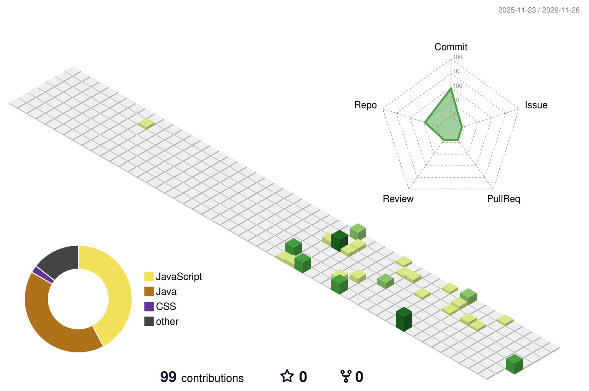

<!-- ========== 3D PROFILE BANNER ========== -->

  

<h1 align="center">Hey 👋, I'm Kirithick Raj</h1>

<h3 align="center">
  🚀 Aspiring Full Stack Developer | Java Developer
</h3>

  

  

---

## 👨‍💻 About Me

- 🎓 B.E. Computer Science Engineering Student (2028)
- 💻 Aspiring Full Stack Developer
- 🌱 Currently learning Java, Spring Boot and JavaScript
- 🔭 Working on **HomeFix – Home Appliance Maintenance Platform**
- 🧠 Practicing Data Structures and Algorithms
- 🎯 Goal: Become a skilled Software Developer

---

## 🛠️ Tech Stack

  

---

## 🚀 Featured Project

### 🏠 HomeFix – Home Appliance Maintenance Platform

A web application for managing appliance service bookings, customer authentication, technician assignments and service completion.

**Technologies:** HTML, CSS, JavaScript, Java, Spring Boot, MySQL.

  

---

## 📊 GitHub Statistics

  
  

---

## 🔥 GitHub Streak

  

---

## 🌌 3D Contribution Graph

  

---

## 🐍 Contribution Snake Animation

  <picture>
    <source media="(prefers-color-scheme: dark)"
      srcset="https://raw.githubusercontent.com/kirithick07/kirithick07/output/github-snake-dark.svg">
    
  </picture>

---

## 🎯 Current Goals

- [x] Learn Java fundamentals
- [x] Build HomeFix project
- [ ] Master Java and DSA
- [ ] Improve Spring Boot skills
- [ ] Build more Full Stack projects
- [ ] Become a professional Software Developer

---

## 🤝 Connect With Me

  

---

<h3 align="center">
  💙 Code • Learn • Build • Repeat
</h3>

  ⭐ Thanks for visiting my GitHub profile!

